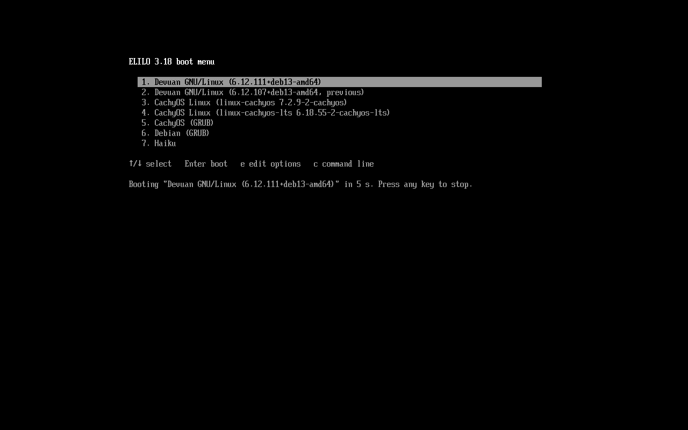

# elilo 3.18 — EFI Linux Loader



elilo is an EFI/UEFI bootloader for Linux. It loads the kernel and initrd
directly from the EFI System Partition (ESP) and passes control to the kernel
via the EFI Handover Protocol.

This is version 3.18. It boots Linux 6.x and 7.x kernels on modern UEFI
firmware and adds:

- an **arrow-key boot menu** listing every entry while the timeout counts down
- **automatic kernel updates** on the Debian family (Debian, Devuan, Ubuntu,
  Mint, ...) and the Arch family (Arch, Artix, CachyOS, EndeavourOS, Manjaro, ...)
- **one shared menu for several installed OSes** on the same ESP
- **chainloading** of other EFI boot loaders — Windows, other distributions'
  GRUB / systemd-boot / Limine / rEFInd, Haiku — found automatically with
  `update-elilo --scan`

Nothing depends on systemd: the scripts need only POSIX `sh`, util-linux and
`efibootmgr`, so they work on sysvinit, OpenRC, runit and s6 systems alike.

See [Changes in 3.18](#changes-in-318) and [Changes from 3.14](#changes-from-314)
for a full account of what changed and why.

elilo is distributed under the GNU General Public License version 2 (or, at
your option, any later version). See [License & Credits](#license--credits)
for the full list of copyright holders.

---

## Table of Contents

1. [Requirements](#requirements)
2. [Building from Source](#building-from-source)
3. [Installation](#installation)
   - [Quick Install](#quick-install)
   - [The Boot Menu](#the-boot-menu)
     - [Editing kernel options](#editing-kernel-options)
     - [The command line](#the-command-line)
   - [Multi-boot: other OSes in the menu](#multi-boot-other-oses-in-the-menu)
   - [Coexisting with GRUB](#coexisting-with-grub)
   - [Finding Your EFI System Partition](#finding-your-efi-system-partition)
   - [Installing the Bootloader Files](#installing-the-bootloader-files)
   - [Writing elilo.conf](#writing-eliloconf)
   - [Registering with the UEFI Boot Manager](#registering-with-the-uefi-boot-manager)
   - [Checking and setting the boot order](#checking-and-setting-the-boot-order)
4. [Automatic Kernel Updates](#automatic-kernel-updates)
5. [Manual Kernel Updates](#manual-kernel-updates)
6. [Partition Naming Reference](#partition-naming-reference)
7. [Changes in 3.18](#changes-in-318)
8. [Changes from 3.14](#changes-from-314)
9. [Comparison with Slackware 15.0](#comparison-with-slackware-150)
10. [License & Credits](#license--credits)

---

## Requirements

- x86_64 UEFI firmware (version 2.0 or later)
- Linux kernel 3.3 or later (boot protocol 2.12+, EFI Handover Protocol)
- Secure Boot disabled (elilo is not signed)
- Tested with Linux 6.12 on Devuan Excalibur / Debian Trixie, 7.0.12 on
  Devuan Freia / Debian Forky, and CachyOS (Arch family)

To install with `install-elilo.sh`: `efibootmgr` and util-linux (`findmnt`,
`lsblk`, `blkid`, `mountpoint`), present on virtually every distribution.

To build from source:

- `gnu-efi` >= 3.0.18 (tested with `gnu-efi_3.0.18-1+deb13u1` from Debian Trixie)
- GCC 12 or later
- binutils with x86_64 EFI support

---

## Building from Source

```bash
sudo apt-get install gnu-efi build-essential

cd elilo
make ARCH=x86_64
```

This produces `elilo.efi` in the top-level directory.

To build the release tarball used in [Quick Install](#quick-install):

```bash
./release-tarball.sh 3.18      # writes elilo-3.18.tar.gz
```

The update-elilo tests need no root and no real disks:

```bash
sh tests/run.sh
```

---

## Installation

### Quick Install

The easiest way to install elilo is with the included installer script. It
detects your distribution, ESP, root file system and kernel options, then
handles everything in one command:

```bash
tar -xf elilo-3.18.tar.gz
cd elilo-3.18
sudo ./install-elilo.sh
```

Options:

| Option | Effect |
|---|---|
| `--esp DIR` | Use the ESP mounted at `DIR` instead of auto-detecting `/boot/efi`, `/efi` or `/boot` |
| `--yes` | Accept the detected values without asking |

The script will:

- Show what it detected (OS, ESP, root, kernel options) and let you change
  the kernel options before anything is written
- Create `<ESP>/EFI/elilo/` and copy `elilo.efi`
- Install `update-elilo` to `/usr/local/sbin/` and the kernel hook for your
  distribution, so every future kernel upgrade updates elilo automatically:
  - Debian family: `/etc/kernel/{postinst,postrm}.d/zz-update-elilo`
    (also used on any distribution that runs `/etc/kernel/postinst.d`)
  - Arch family: `/etc/pacman.d/hooks/zz-update-elilo.hook`
- Write `/etc/elilo/update.conf` with the detected values (`OS_ID`, `LAYOUT`,
  `ROOT_DEV=UUID=...`, `APPEND`, ...)
- Copy the kernels and initrds to the ESP and generate `elilo.conf`
- Register an `elilo` UEFI boot entry via `efibootmgr` (only for the first OS
  on that ESP)
- Offer to search your disks for other OSes and boot loaders and add them to
  the menu (see [Multi-boot](#multi-boot-other-oses-in-the-menu))

The kernel options default to those of the running kernel (minus `root=`,
`initrd=` and `BOOT_IMAGE=`), so distribution specifics such as
`rw rootflags=subvol=/@` on a btrfs root carry over. Review
`/etc/elilo/update.conf` after the install if you want to adjust anything,
then run `sudo update-elilo` and reboot to test.

> **Upgrading from 3.17.x:** your existing `/etc/elilo/update.conf` keeps
> working unchanged (single-OS layout). To switch to the new layout — needed
> for the shared multi-OS menu — re-run the installer and answer **y** to
> *Replace it with the detected settings?*. The old file is saved as
> `/etc/elilo/update.conf.old`; the kernels move to `EFI/elilo/<OS_ID>/` on
> the next update.

> **Check the boot order before rebooting.** Creating a boot entry does not
> guarantee the firmware tries it first, and if an `elilo` entry already exists
> the installer skips `efibootmgr` entirely. Run `efibootmgr -v` and, if elilo
> is not first in `BootOrder`, set it first with `sudo efibootmgr --bootorder
> XXXX` — see [Checking and setting the boot order](#checking-and-setting-the-boot-order).

> If you prefer to install step by step — or your distribution is neither
> Debian- nor Arch-based — see the manual installation sections below.

---

### The Boot Menu

Configs written by `update-elilo` use the `menu` chooser (`chooser=menu` in
`elilo.conf`). Every boot entry is listed straight away, with the default
highlighted and a countdown underneath:

```
ELILO 3.18 boot menu

   1. Devuan GNU/Linux (7.0.12+deb14-amd64)
   2. Devuan GNU/Linux (6.12.111+deb13-amd64, previous)
   3. CachyOS Linux (linux-cachyos 6.17.2-2-cachyos)
   4. Windows Boot Manager
   5. Haiku

↑/↓ select   Enter boot   e edit options   c command line

Booting "Devuan GNU/Linux (7.0.12+deb14-amd64)" in 5 s. Press any key to stop.
```

| Key | Action |
|---|---|
| any key | stop the countdown |
| ↑ / ↓, PgUp / PgDn, Home / End | move the selection |
| `1`–`9` | jump to that entry |
| Enter | boot the selected entry |
| `e` | [edit the kernel options](#editing-kernel-options) of the selected entry for this boot |
| `c` or Tab | switch to the classic `ELILO boot:` [command line](#the-command-line) |

With `PROMPT=0` in `update.conf`, elilo boots the default without showing the
menu; pressing a key before `TIMEOUT` runs out still opens it.

Hand-written `elilo.conf` files that do not set `chooser=` keep the classic
prompt; add `chooser=menu` to use the menu.

#### Editing kernel options

Press `e` on an entry to see the full command line elilo is about to pass to
the kernel, for example:

```
Options for "Devuan GNU/Linux (6.12.111+deb13-amd64)"
Enter boots with these options, Esc cancels, Ctrl-U clears the line.

root=UUID=0a1b2c3d-4e5f-6789-abcd-ef0123456789 ro quiet
```

| Key | Action |
|---|---|
| typing | adds characters at the end of the line |
| Backspace | deletes the last character |
| Ctrl-U | clears the whole line |
| Enter | boots the entry with the edited line |
| Esc | returns to the menu without changing anything |

The line replaces the entry's options for **this boot only**: nothing is
written to disk, and the next boot uses `elilo.conf` again. The kernel and
initrd stay those of the entry. Only plain ASCII characters can be typed, and
there is no cursor movement: to change something in the middle, delete back to
it with Backspace, or clear the line with Ctrl-U and type it again.

Keep the `root=` part, or the kernel will not find its root file system.
Common one-off changes:

| Change | Why |
|---|---|
| remove `quiet` | see the kernel and init messages while booting |
| add `nomodeset` | get a picture when the graphics driver fails |
| add `single` | boot to single-user (rescue) mode |
| add `init=/bin/sh` | get a root shell without running init, to repair a broken system |

For a chainloaded entry (another boot loader) the line holds the load options
passed to that loader, and is usually empty.

To change the options permanently, edit `APPEND` in `/etc/elilo/update.conf`
and run `sudo update-elilo`.

#### The command line

Press `c` (or Tab) in the menu for the classic `ELILO boot:` prompt, the
interface of elilo 3.17 and earlier. It waits without a countdown until you
press Enter.

**Booting:**

| Type | Result |
|---|---|
| Enter on an empty line | boots the default entry |
| a label, e.g. `devuan` | boots that entry (the label, not the description; Tab lists them) |
| a label and options, e.g. `devuan nomodeset` | boots that entry with the options **added** to its own |
| a kernel path and options, e.g. `/EFI/elilo/devuan/vmlinuz-6.12.111+deb13-amd64 root=UUID=... ro` | boots any kernel on the ESP, without an initrd; a device from the `=` list can come first, as `dev_name:/path` |

**Information** (only as the first character on the line):

| Key | Shows |
|---|---|
| Tab | the list of labels; after a label, e.g. `devuan` then Tab, that entry's description, command line and initrd |
| `=` | the devices elilo can read, with the names to use in `dev_name:` |
| `%` | elilo's variables |
| `&` | the boot device, default path and config file in use |
| `?` | a short help |

**Editing:** Backspace deletes a character, Ctrl-U clears the line, Ctrl-C
starts a new line, and Ctrl-D leaves elilo so the firmware moves on to its next
boot option.

There is no way back to the menu from the prompt; reboot to see it again.

---

### Multi-boot: other OSes in the menu

#### Several Linux installs sharing one elilo

Each installed Linux can manage its own entries in **one** elilo menu on one
ESP. Each OS copies its kernels to `EFI/elilo/<OS_ID>/` and writes its
entries to `EFI/elilo/entries/<NN>-<OS_ID>.conf`; `update-elilo` merges every
file in `entries/` into `elilo.conf`. A kernel upgrade on one OS never
touches the others' entries.

1. Install elilo on the first OS as usual (it registers the UEFI boot entry
   and owns the global settings: timeout, default entry).
2. On every other Linux install, mount **the same ESP** — typically through
   `/etc/fstab`, at a free mount point such as `/efi` if `/boot/efi` is
   already used by that OS's own ESP:

   ```
   # find the ESP elilo lives on: lsblk -o NAME,FSTYPE,PARTTYPE,PARTUUID
   UUID=XXXX-XXXX  /efi  vfat  umask=0077,nofail  0  2
   ```

   `nofail` keeps that OS bootable if the disk is ever missing.
3. Run the installer there, pointing at that mount:

   ```bash
   sudo mount /efi
   sudo ./install-elilo.sh --esp /efi
   ```

   It sees the existing menu, adds this OS after the others, leaves the UEFI
   boot entries and global settings alone, and installs this distribution's
   kernel hook.

The global settings (`TIMEOUT`, `PROMPT`, `DEFAULT`) are taken from the OS
whose `update.conf` has `GLOBAL_OWNER=1`. `DEFAULT` takes any label, e.g.
`DEFAULT=cachyos`.

#### Other boot loaders and OSes: `update-elilo --scan`

```bash
sudo update-elilo --scan          # asks before adding each one
sudo update-elilo --scan --yes    # adds everything found
```

`--scan` looks at every partition and offers a menu entry for:

- boot loaders on any EFI System Partition — Windows Boot Manager, other
  distributions' GRUB (or shim), systemd-boot, Limine, rEFInd, or the
  removable-media loader `EFI/BOOT/BOOTX64.EFI` when nothing else is there.
  ESPs that are not mounted are mounted read-only for the scan and unmounted
  afterwards.
- **Haiku** loaders already on an ESP: `EFI/HAIKU/BOOTX64.EFI` (the layout
  from Haiku's guide), any `EFI/haiku*/haiku_loader*.efi`, or a removable-media
  loader that is Haiku's. See [Haiku](#haiku) below for a Haiku install that has
  no ESP of its own.

Entries found by `--scan` are chainloaded: elilo starts that boot loader,
which boots its OS. They are located by PARTUUID, so they keep working when
disks are renumbered. Running `--scan` again replaces everything the previous
scan added.

#### Haiku

Haiku's EFI loader finds the Haiku partition by itself, so it does not need
to be on the same disk: it can sit on elilo's ESP. A Haiku install without an
ESP of its own works like this. Two things to know:

- **Getting the loader.** Haiku keeps `haiku_loader.efi` inside its system
  package, which cannot be read from Linux, so `--scan` cannot copy it from
  the Haiku partition. Take it from the Haiku ISO of the same release, where
  it is `EFI/BOOT/BOOTX64.EFI` in the ISO's EFI boot image:

  ```bash
  xorriso -osirrox on -indev haiku-*.iso -extract_boot_images bootimg/
  mcopy -i bootimg/eltorito_img2_uefi.img ::/EFI/BOOT/BOOTX64.EFI haiku_loader.efi
  sudo update-elilo --add-efi haiku "Haiku" haiku_loader.efi
  ```

  From a running Haiku the same file is
  `/boot/system/data/platform_loaders/haiku_loader.efi`. Add it again after
  upgrading Haiku so the loader matches the installed release.
- **Partition type.** On a GPT disk Haiku's loader only picks a partition by
  itself when its type is *Haiku BFS*
  (`42465331-3ba3-10f1-802a-4861696b7521`). If the Haiku partition has another
  type, for example *EFI System*, the loader stops at its menu with no boot
  volume selected. `--scan` warns about this and prints the fix, which changes
  only the partition type, not the data:

  ```bash
  sudo sfdisk --part-type /dev/sdX N 42465331-3ba3-10f1-802a-4861696b7521
  ```

#### Adding or removing entries by hand

```bash
# copy an EFI binary onto elilo's ESP and add it to the menu
sudo update-elilo --add-efi haiku "Haiku" /path/to/haiku_loader.efi

# chainload a loader that stays on another partition (PARTUUID from lsblk)
sudo update-elilo --add-efi windows "Windows" /EFI/Microsoft/Boot/bootmgfw.efi \
    --device 0a1b2c3d-1111-2222-3333-444455556666

# remove an entry added by --scan or --add-efi
sudo update-elilo --remove-entry windows
```

#### Chainload entries in elilo.conf

```
image=/EFI/Microsoft/Boot/bootmgfw.efi
  label=windows
  description="Windows Boot Manager"
  device=0a1b2c3d-1111-2222-3333-444455556666
  chainload
```

| Option | Meaning |
|---|---|
| `chainload` | `image=` is an EFI binary started with the firmware's LoadImage/StartImage instead of a Linux kernel |
| `device=` | PARTUUID of the partition holding it (GPT `xxxxxxxx-xxxx-xxxx-xxxx-xxxxxxxxxxxx` or MBR `xxxxxxxx-NN`). Without it, the path is on elilo's own ESP |
| `append=` | passed to the binary as its load options |

If the binary cannot be loaded, or it exits, elilo shows the error and returns
to the menu.

---

### Coexisting with GRUB

**You do not need to remove GRUB to install elilo.** UEFI firmware maintains an
ordered list of boot entries. You can add elilo as an additional entry and keep
GRUB intact. If elilo fails to boot, simply select GRUB from the UEFI boot menu
(usually reached by pressing F12, F9, Esc, or Del at startup depending on your
firmware).

To set the default boot entry back to GRUB at any time:

```bash
# List all boot entries
efibootmgr

# Set GRUB as default (replace XXXX with GRUB's entry number)
sudo efibootmgr --bootorder XXXX,YYYY,...
```

It is strongly recommended to verify elilo boots correctly before removing any
existing GRUB entry.

---

### Finding Your EFI System Partition

The EFI System Partition (ESP) is a FAT32 partition with the EFI System
partition type flag. Find it with:

```bash
lsblk -o NAME,FSTYPE,PARTTYPE,MOUNTPOINT
```

or:

```bash
sudo fdisk -l | grep -i efi
```

Common locations:

| Device type | Typical ESP device |
|---|---|
| SATA / SCSI SSD or HDD | `/dev/sda1` |
| Second SATA drive | `/dev/sdb1` |
| NVMe SSD | `/dev/nvme0n1p1` |
| Second NVMe | `/dev/nvme1n1p1` |
| eMMC (embedded, tablets/netbooks) | `/dev/mmcblk0p1` |
| SD card | `/dev/mmcblk1p1` |

The ESP is almost always the first partition. If you are unsure, check that the
partition is FAT32 and is mounted at `/boot/efi`:

```bash
mount | grep efi
# or
cat /etc/fstab | grep efi
```

If the ESP is not already mounted, mount it:

```bash
sudo mount /dev/sdXY /boot/efi
```

---

### Installing the Bootloader Files

Create a directory for elilo on the ESP and install the files:

```bash
sudo mkdir -p /boot/efi/EFI/elilo

# Install the bootloader binary
sudo cp elilo.efi /boot/efi/EFI/elilo/elilo.efi

# Copy the kernel and initrd to the ESP, keeping the versioned filename
# Replace the version string with the output of: uname -r
sudo cp /boot/vmlinuz-6.12.90+deb13-amd64    /boot/efi/EFI/elilo/vmlinuz-6.12.90+deb13-amd64
sudo cp /boot/initrd.img-6.12.90+deb13-amd64 /boot/efi/EFI/elilo/initrd.img-6.12.90+deb13-amd64
```

> **Note:** elilo reads the kernel and initrd from the ESP (FAT32). The files
> must be copied there — symlinks are not supported on FAT32. Use the versioned
> filename (e.g. `vmlinuz-6.12.90+deb13-amd64`) rather than a generic name so
> it is always clear which kernel version is on the ESP. When the kernel is
> upgraded, you must copy the new files and update `elilo.conf` manually (see
> [Keeping elilo Up to Date](#keeping-elilo-up-to-date-after-a-kernel-upgrade)).

Then write the config file (see next section) and copy it:

```bash
sudo cp elilo.conf /boot/efi/EFI/elilo/elilo.conf
```

elilo looks for `elilo.conf` in the same directory as `elilo.efi` by default.

---

### Writing elilo.conf

The `image=` and `initrd=` paths are relative to the root of the ESP. The
`root=` value is the Linux device name of your root filesystem partition — this
is the partition elilo tells the kernel to mount as `/`, not the ESP itself.

**Identify your root partition:**

```bash
df -h /
# or
lsblk
```

Below are complete example configs for different hardware. Copy the one that
matches your setup, adjust the `root=` device and `append=` line as needed,
then save as `/boot/efi/EFI/elilo/elilo.conf`.

---

#### SATA / SCSI drive (sda, sdb, ...)

```
# elilo.conf — SATA/SCSI example
# ESP:  /dev/sda1
# Root: /dev/sda2

prompt
timeout=50
default=linux

image=/EFI/elilo/vmlinuz-6.12.90+deb13-amd64
  label=linux
  initrd=/EFI/elilo/initrd.img-6.12.90+deb13-amd64
  root=/dev/sda2
  append="ro quiet"
```

Replace `6.12.90+deb13-amd64` with your actual kernel version (`uname -r`).
If your root partition is on a second drive or a different partition number,
change `root=` accordingly — for example `root=/dev/sdb3`.

---

#### NVMe SSD (nvme0n1, nvme1n1, ...)

NVMe devices use a different naming scheme: the drive is `nvme0n1` and
partitions are `nvme0n1p1`, `nvme0n1p2`, etc.

```
# elilo.conf — NVMe example
# ESP:  /dev/nvme0n1p1
# Root: /dev/nvme0n1p2

prompt
timeout=50
default=linux

image=/EFI/elilo/vmlinuz-6.12.90+deb13-amd64
  label=linux
  initrd=/EFI/elilo/initrd.img-6.12.90+deb13-amd64
  root=/dev/nvme0n1p2
  append="ro quiet"
```

Replace `6.12.90+deb13-amd64` with your actual kernel version (`uname -r`).
For a second NVMe drive use `nvme1n1p2`, and so on. If your root partition is
on a different partition number, change `root=` accordingly — for example
`root=/dev/nvme0n1p3`.

---

#### eMMC storage (mmcblk0, mmcblk1, ...)

eMMC devices follow the same `pN` suffix pattern as NVMe.

```
# elilo.conf — eMMC example
# ESP:  /dev/mmcblk0p1
# Root: /dev/mmcblk0p2

prompt
timeout=50
default=linux

image=/EFI/elilo/vmlinuz-6.12.90+deb13-amd64
  label=linux
  initrd=/EFI/elilo/initrd.img-6.12.90+deb13-amd64
  root=/dev/mmcblk0p2
  append="ro quiet"
```

Replace `6.12.90+deb13-amd64` with your actual kernel version (`uname -r`).
For a second eMMC device use `mmcblk1p2`. If your root partition is on a
different partition number, change `root=` accordingly — for example
`root=/dev/mmcblk0p3`.

---

#### Multiple boot entries (e.g. fallback kernel)

```
# elilo.conf — multiple kernels
prompt
timeout=50
default=linux

image=/EFI/elilo/vmlinuz-6.13.5+deb13-amd64
  label=linux
  description="Devuan Linux 6.13 (current)"
  initrd=/EFI/elilo/initrd.img-6.13.5+deb13-amd64
  root=/dev/sda2
  append="ro quiet"

image=/EFI/elilo/vmlinuz-6.12.90+deb13-amd64
  label=linux.old
  description="Devuan Linux 6.12 (previous)"
  initrd=/EFI/elilo/initrd.img-6.12.90+deb13-amd64
  root=/dev/sda2
  append="ro quiet"
```

Replace the version strings with your current and previous kernel versions
(`uname -r` gives the running version). Change `root=` to match your actual
root partition — for example `root=/dev/nvme0n1p2` or `root=/dev/mmcblk0p2`
for NVMe or eMMC systems.

---

#### Common append options

| Option | Effect |
|---|---|
| `ro` | Mount root read-only at boot (standard) |
| `quiet` | Suppress most kernel messages |
| `nomodeset` | Disable kernel modesetting (safe fallback if display is blank) |
| `rootfstype=ext4` | Explicitly set root filesystem type |
| `init=/sbin/init` | Use sysvinit explicitly (Devuan/Artix) |
| `single` | Boot to single-user mode |

---

### Registering with the UEFI Boot Manager

After copying the files, register elilo as a UEFI boot entry. Replace
`/dev/sdX` and the partition number with your actual ESP device.

**SATA example (ESP on /dev/sda1):**

```bash
sudo efibootmgr --create \
  --disk /dev/sda \
  --part 1 \
  --label "elilo" \
  --loader "\\EFI\\elilo\\elilo.efi"
```

**NVMe example (ESP on /dev/nvme0n1p1):**

```bash
sudo efibootmgr --create \
  --disk /dev/nvme0n1 \
  --part 1 \
  --label "elilo" \
  --loader "\\EFI\\elilo\\elilo.efi"
```

**eMMC example (ESP on /dev/mmcblk0p1):**

```bash
sudo efibootmgr --create \
  --disk /dev/mmcblk0 \
  --part 1 \
  --label "elilo" \
  --loader "\\EFI\\elilo\\elilo.efi"
```

Verify the entry was added:

```bash
efibootmgr -v
```

The new entry will appear in the boot order list. On the next reboot your
firmware will offer both elilo and any existing entries (e.g. GRUB).

### Checking and setting the boot order

Creating a boot entry does **not** guarantee the firmware will try it first.
On most machines `efibootmgr --create` (and the installer) puts the new `elilo`
entry at the top of the boot order automatically. Some firmware does not — it
adds the entry but leaves it behind the existing default, so the machine keeps
booting whatever was first (GRUB, the firmware fallback, etc.). This has been
seen on eMMC/SD (`mmcblk`) systems in particular, but it is firmware-specific
and can happen on any machine — so always verify after installing.

> Note: if an `elilo` boot entry already exists, the installer skips
> `efibootmgr` and therefore does not touch the boot order at all. After a
> re-install you must check and, if needed, fix the order yourself.

Check the current order:

```bash
efibootmgr -v
```

The `BootOrder:` line near the top lists entry numbers in the order the firmware
tries them, for example:

```
BootOrder: 0003,0001,2001
Boot0001* elilo	HD(1,GPT,...)/File(\EFI\elilo\elilo.efi)
Boot0003* debian	HD(1,GPT,...)/File(\EFI\debian\grubx64.efi)
```

Find elilo's four-digit number (here `0001`). If it is not first, move it to the
front — list the remaining entries after it so they stay available as fallbacks:

```bash
# Replace XXXX with elilo's number, then the others in your preferred order
sudo efibootmgr --bootorder XXXX,0003,2001
```

To make the firmware try only elilo first, you can pass just its number:

```bash
sudo efibootmgr --bootorder XXXX
```

Re-run `efibootmgr -v` to confirm the new order, then reboot.

---

## Automatic Kernel Updates

The most common complaint about elilo is being locked out after a kernel
upgrade. The `update-elilo` script and kernel hooks in the `scripts/` and
`hooks/` directories solve this: install them once and every kernel upgrade
(`apt upgrade`, `pacman -Syu`, ...) automatically copies the new kernel to
the ESP and regenerates `elilo.conf`, exactly as GRUB runs `update-grub`.

### How it works

- **Debian family** (`LAYOUT=debian`; kernels named
  `/boot/vmlinuz-<version>`): every script in `/etc/kernel/postinst.d/` runs
  after each kernel install, with the new version as `$1`. The
  `zz-update-elilo` hook calls `update-elilo`, which copies the newest kernel
  and initrd to the ESP as the default entry, and the next newest as the
  `<OS_ID>-old` fallback. When a kernel is removed, the postrm hook
  regenerates the config and the removed kernel leaves the ESP.
- **Arch family** (`LAYOUT=arch`; kernels named `/boot/vmlinuz-<pkgbase>`,
  e.g. `linux`, `linux-lts`, `linux-cachyos`): the pacman hook
  `zz-update-elilo.hook` runs after mkinitcpio's own hook whenever a kernel,
  module, firmware, DKMS module or microcode package changes. Every installed
  kernel gets an entry (`<OS_ID>` for `DEFAULT_KERNEL` or `linux`,
  `<OS_ID>-lts`, `<OS_ID>-zen`, ...). CPU microcode (`/boot/*-ucode.img`) is
  prepended to each initramfs, since elilo loads a single initrd.

Files that have not changed are not rewritten. If the ESP does not have room
for the new files, `update-elilo` stops before touching `elilo.conf`.

### One-time setup

**Step 1 — Install update-elilo:**

```bash
sudo cp scripts/update-elilo /usr/local/sbin/update-elilo
sudo chmod 755 /usr/local/sbin/update-elilo
```

**Step 2 — Create the config directory and edit the config:**

```bash
sudo mkdir -p /etc/elilo
sudo cp scripts/elilo-update.conf /etc/elilo/update.conf
sudo nano /etc/elilo/update.conf
```

Set these values to match your system (the file explains each one):

```sh
OS_ID=debian                        # short name: kernels go in ELILO_DIR/<OS_ID>/
OS_NAME="Debian GNU/Linux"          # shown in the menu
LAYOUT=debian                       # debian or arch (see the comments in the file)
ELILO_DIR=/boot/efi/EFI/elilo       # where elilo.efi lives on the ESP
ROOT_DEV=UUID=...                   # findmnt -n -o UUID /  gives yours
APPEND="ro quiet"                   # kernel parameters
```

**Step 3 — Install the kernel hook for your distribution:**

Debian family (or any distribution that runs `/etc/kernel/postinst.d`):

```bash
sudo cp hooks/postinst.d/zz-update-elilo /etc/kernel/postinst.d/zz-update-elilo
sudo cp hooks/postrm.d/zz-update-elilo   /etc/kernel/postrm.d/zz-update-elilo
sudo chmod 755 /etc/kernel/postinst.d/zz-update-elilo
sudo chmod 755 /etc/kernel/postrm.d/zz-update-elilo
```

Arch family:

```bash
sudo mkdir -p /etc/pacman.d/hooks
sudo cp hooks/pacman/zz-update-elilo.hook /etc/pacman.d/hooks/
```

**Step 4 — Run update-elilo once to generate the initial config:**

```bash
sudo update-elilo
```

This copies the current kernels to the ESP and writes `elilo.conf`. From this
point on, kernel upgrades are handled automatically.

> **Note:** `update-elilo` regenerates `elilo.conf` completely. Put custom
> entries in their own file in `EFI/elilo/entries/` (or add them with
> `update-elilo --add-efi`) so they survive; anything edited directly in
> `elilo.conf` is overwritten.

### Other distributions

Distributions that name kernels `/boot/vmlinuz-<version>` (with an initrd
called `initrd.img-<version>`, `initrd-<version>.img` or
`initramfs-<version>.img`) can use `LAYOUT=debian`. If the distribution runs
`/etc/kernel/postinst.d` hooks (Gentoo's installkernel does), the Debian hooks
work as they are. Otherwise run `sudo update-elilo` after each kernel upgrade.

---

## Manual Kernel Updates

> **Warning:** Without the automatic hooks above, elilo reads the kernel and
> initrd by filename from the ESP and has no way to find new kernels on its own.
> After every kernel upgrade you must manually copy the new files and update
> `elilo.conf`. Failure to do this will cause elilo to boot the old kernel or
> fail to find the kernel entirely.

**Step 1 — Identify the new kernel:**

```bash
ls /boot/vmlinuz-* /boot/initrd.img-*
```

You will see both the old and new versions, for example:

```
/boot/vmlinuz-6.12.90+deb13-amd64
/boot/vmlinuz-6.13.5+deb13-amd64   ← new
/boot/initrd.img-6.12.90+deb13-amd64
/boot/initrd.img-6.13.5+deb13-amd64 ← new
```

**Step 2 — Copy the new kernel to the ESP:**

```bash
sudo cp /boot/vmlinuz-6.13.5+deb13-amd64    /boot/efi/EFI/elilo/vmlinuz-6.13.5+deb13-amd64
sudo cp /boot/initrd.img-6.13.5+deb13-amd64 /boot/efi/EFI/elilo/initrd.img-6.13.5+deb13-amd64
```

Replace `6.13.5+deb13-amd64` with your actual new kernel version (`uname -r`
on the running system gives the current version; the new one will be visible
in `ls /boot/vmlinuz-*`).

**Step 3 — Update elilo.conf:**

Update the `image=` and `initrd=` lines in `/boot/efi/EFI/elilo/elilo.conf`:

```
image=/EFI/elilo/vmlinuz-6.13.5+deb13-amd64
  label=linux
  initrd=/EFI/elilo/initrd.img-6.13.5+deb13-amd64
  root=/dev/sda2
  append="ro quiet"
```

Keep the old kernel as a second entry (label `linux-old`) until the new kernel
boots correctly, then remove it on the next upgrade.

> **If elilo fails to boot after a kernel upgrade:** select GRUB (or your
> previous boot entry) from the UEFI firmware menu to boot the old kernel while
> you diagnose the problem.

---

## Partition Naming Reference

| Hardware | Drive | ESP (partition 1) | Root (partition 2) |
|---|---|---|---|
| SATA SSD / HDD, first drive | `/dev/sda` | `/dev/sda1` | `/dev/sda2` |
| SATA SSD / HDD, second drive | `/dev/sdb` | `/dev/sdb1` | `/dev/sdb2` |
| NVMe SSD, first drive | `/dev/nvme0n1` | `/dev/nvme0n1p1` | `/dev/nvme0n1p2` |
| NVMe SSD, second drive | `/dev/nvme1n1` | `/dev/nvme1n1p1` | `/dev/nvme1n1p2` |
| eMMC (built-in), first device | `/dev/mmcblk0` | `/dev/mmcblk0p1` | `/dev/mmcblk0p2` |
| SD card | `/dev/mmcblk1` | `/dev/mmcblk1p1` | `/dev/mmcblk1p2` |

The partition numbers above assume a standard layout (ESP first, root second).
Your layout may differ — always verify with `lsblk` or `fdisk -l`.

---

## Changes in 3.18

### Boot menu (`choosers/menu.c`)

A new `menu` chooser replaces the "dots, then a bare `ELILO boot:` prompt"
experience: all entries are listed during the countdown and selected with the
arrow keys (see [The Boot Menu](#the-boot-menu)). It needs no message files;
the layout follows the console size and scrolls when there are many entries.
`e` edits an entry's options and `c` falls back to the classic prompt. The
command-line building shared by the choosers moved to
`chooser_build_cmdline()` (`chooser.c`), fixing an operator-precedence error
in the length check that the old copies carry. The classic prompt no longer
prints countdown dots forever when the timeout is infinite.

### Chainloading (`chainload.c`, `config.c`, `elilo.c`)

New image options `chainload` and `device=<PARTUUID>`. A chainload entry is
started with the firmware's `LoadImage`/`StartImage` (through
`uefi_call_wrapper`, like every other EFI call). The partition is found by
matching the GPT GUID, or the MBR signature and partition number, in the
hard-drive node of each file system's device path; if it is not there, all
controllers are connected (firmware "fast boot" may connect only the boot
disk) and the search is repeated. If the image fails to load or returns,
elilo prints the error and goes back to the menu.

### update-elilo, hooks and installer

- **Fragment layout** for one shared menu across several OSes (`OS_ID`,
  `entries/*.conf`, per-OS kernel directories); configs without `OS_ID` keep
  the 3.17 layout and output.
- **Arch family** support (`LAYOUT=arch`): pkgbase-named kernels, microcode
  prepended to the initramfs, optional fallback initramfs entries, and a
  pacman hook.
- `--scan` finds Windows, other boot loaders and Haiku loaders on any ESP,
  and warns when a Haiku partition has a type Haiku's loader will not boot
  from; `--add-efi` and `--remove-entry` manage chainload entries by hand.
- `tests/`: update-elilo test suites (`sh tests/run.sh`), no root needed.
- btrfs: the `[/subvol]` suffix printed by `findmnt` is stripped from the root
  device, and `rootflags=subvol=...` is added when missing.
- ESP space is checked before copying; unchanged files are not rewritten.
- Generated strings are kept to printable ASCII so elilo's byte-oriented
  config parser always reads them correctly.
- Kernel hooks act whenever they are run outside dpkg (Gentoo's installkernel,
  manual runs) and only skip non-`configure` dpkg invocations.
- `install-elilo.sh`: distribution detection, `--esp` / `--yes`, `root=UUID=`,
  kernel options taken from the running system, joining an existing shared
  menu, and an offer to run `--scan`.
- No systemd dependency anywhere; partition data falls back to `blkid -p` when
  no udev database is available.

---

## Changes from 3.14

elilo 3.14 was last updated in January 2011. It was written against gnu-efi 3.0
and Linux boot protocol 2.09. The fixes below make it build and boot correctly
on modern UEFI firmware with Linux kernels in the 6.x series (tested with
Debian/Devuan 6.12).

---

### Fix 1 — Build: Add `.rodata` to objcopy sections

**File:** `Make.rules`

Modern GCC places string literals in `.rodata`, a section separate from `.text`.
The original objcopy invocation did not include `-j .rodata`, so all `Print()`
strings were silently dropped from the EFI binary. The resulting elilo.efi had
no visible output at all.

```makefile
# Before:
$(OBJCOPY) -j .text -j .sdata -j .data -j .dynamic ...

# After:
$(OBJCOPY) -j .text -j .sdata -j .data -j .rodata -j .dynamic ...
```

---

### Fix 2 — Compile: Remove conflicting `StrnCpy` declaration

**Files:** `strops.h`, `strops.c`

gnu-efi 3.0.18 declares `StrnCpy` as returning `VOID`. elilo 3.14 declares it
as returning `CHAR16 *`. GCC 12+ treats this as a hard type-conflict error.

Since no call site in elilo uses the return value, elilo's shadow declaration
and implementation were removed. gnu-efi's version is used instead.

---

### Fix 3 — Compile: `HandleProtocol` void-pointer cast

**File:** `x86_64/system.c`

`HandleProtocol` expects a `VOID **` but elilo passed a typed pointer directly.
Added the required `(VOID **)` cast.

---

### Fix 4 — ABI bug: `SetMem` zeroed 0 bytes (config parse failure)

**File:** `x86_64/sysdeps.h`

This was the root cause of the `(null) already defined` error during config
parsing.

elilo is compiled with SysV ABI (`-DEFI_FUNCTION_WRAPPER`). `SetMem` in
`libefi.a` is declared `EFIAPI` (Microsoft x64 ABI), meaning its `Size`
argument is passed in `RCX`. When called from SysV code, the compiler puts
`Size` in `RDX` (the second SysV register), not `RCX`. `SetMem` reads zero
from `RCX` and zeroes nothing. The config parser then found every label
"already defined" because its lookup table was never cleared.

Fix: replace `Memset(a,v,n)` with `ZeroMem((a),(n))`. `ZeroMem` in the
installed gnu-efi does not carry `EFIAPI`, so it uses SysV ABI and the call is
correct without any wrapper.

---

### Fix 5 — ABI bug: `CopyMem` corrupted boot_params copy

**File:** `x86_64/sysdeps.h`

The same MS-ABI problem affects `CopyMem`. It is declared `EFIAPI` in
`libefi.a`. A direct call from SysV code passes arguments in the wrong
registers, silently corrupting the copy of the kernel setup header into
boot_params.

Fix: route all `CopyMem` calls through `uefi_call_wrapper(CopyMem, 3, ...)`,
which is the SysV→MS ABI trampoline already provided by gnu-efi for exactly
this purpose.

---

### Fix 6 — Bug: `config_error()` printed `(null)` for all messages

**File:** `config.c`

`config_error()` was calling `IPrint` without passing its `va_list`, so the
format string was evaluated against garbage stack data. Changed to use `VPrint`
with a proper `va_list`.

---

### Fix 7 — Bug: File-read retry triggered on every successful read

**File:** (file operations layer)

The retry condition was `ret != EFI_SUCCESS`, which fired on every successful
read that returned fewer bytes than requested (a normal short-read condition).
The file was re-read from the beginning repeatedly. Changed to retry only on
`EFI_NOT_FOUND` or `EFI_TFTP_ERROR`.

---

### Fix 8 — Bug: `cmdline_addr` always zero

**File:** `x86_64/system.c`

Boot protocol 2.06+ locates the kernel command line via the absolute address in
`cmdline_addr`. elilo was setting it to 0. The kernel therefore booted without
any command-line arguments.

```c
/* Before */
bp->s.cmdline_addr = 0x0;

/* After */
bp->s.cmdline_addr = (UINT32)(UINT64)cmdline;
```

Also added `bp->s.loader_flags |= LDRFLAG_CAN_USE_HEAP` so the kernel knows
it may use the heap area.

---

### Fix 9 — Bug: Kernel size ceiling too small for 6.x kernels

**File:** `x86_64/bzimage.c`

The original ceiling was `kernel_size = 0x800000` (8 MB). The Debian 6.12
bzImage body is approximately 11.5 MB. The kernel body was truncated at 8 MB,
meaning the EFI stub — which is appended at body offset ~11.4 MB — was never
loaded into memory. Jumping to the handover entry address therefore landed in
uninitialised memory.

Rather than guessing a new fixed limit, we read `init_size` from the kernel
setup header and use it when it exceeds the default:

```c
UINT32 init_sz = ps->s.pad_9[10];
if (init_sz > (UINT32)kernel_size)
    kernel_size = (UINTN)init_sz;
```

For the Debian 6.12 kernel `init_size` is 56 MB, which covers the full
11.5 MB compressed image with room to spare.

Slackware's patch instead increases the fixed limit to 16 MB. That is not
enough for a 6.12 bzImage and would still truncate the EFI stub.

---

### Fix 10 — Core boot fix: EFI Handover Protocol

**Files:** `x86_64/sysdeps.h`, `elilo.c`

elilo 3.14 boots by calling `ExitBootServices()` itself and then jumping
directly to the kernel's protected-mode entry point. On modern UEFI firmware
this fails: the kernel expects to manage EFI shutdown through its own stub,
which sets up memory descriptors, tears down Boot Services, and transitions
cleanly.

The EFI Handover Protocol (Linux boot protocol 2.12+, kernels >= 3.3) solves
this. The bootloader keeps Boot Services active and calls the kernel's EFI stub
entry point directly, passing `(image_handle, efi_system_table, boot_params)`.
The stub takes over from there.

Entry-point location:

- `handover_offset` (boot params field at offset `0x264`) is the offset from
  the start of the compressed kernel body to the 32-bit EFI entry point.
- The 64-bit entry is always `handover_offset + 512`.
- `kernel_load_address` is where elilo loaded the body, so the entry address is:

```c
(UINT8 *)kernel_load_address + BP_HANDOVER_OFFSET(bp) + 512
```

The handover is attempted before the legacy `ExitBootServices` + `start_kernel`
fallback, which is kept for kernels older than 3.3.

---

### Fix 11 — Critical ABI fix: handover entry uses SysV, not MS ABI

**File:** `x86_64/sysdeps.h`

This was the fix that made the kernel actually boot. In older kernels (up to
approximately 5.x), `efi64_stub_entry` began with an explicit MS→SysV argument
translation:

```asm
mov %rcx, %rdi   ; handle:     MS arg1 → SysV arg1
mov %rdx, %rsi   ; sys_table:  MS arg2 → SysV arg2
mov %r8,  %rdx   ; boot_params: MS arg3 → SysV arg3
```

Linux 6.x removed this shim. `efi64_stub_entry` is now a one-instruction JMP
trampoline landing directly in SysV code that reads `rdi`, `rsi`, and `rdx`.

The handover function pointer was originally declared with
`__attribute__((ms_abi))`. That caused GCC to place arguments in `rcx`/`rdx`/
`r8`, which the kernel never reads. The kernel received garbage for `handle` and
`sys_table`, crashed immediately, and the result looked like a freeze.

Verified by disassembling the JMP target in the Debian 6.12 bzImage:

```
41 54        push r12
49 89 d4     mov  r12, rdx    ← saves rdx = 3rd SysV arg (boot_params)
55           push rbp
48 89 f5     mov  rbp, rsi    ← saves rsi = 2nd SysV arg (sys_table)
53           push rbx
48 89 fb     mov  rbx, rdi    ← saves rdi = 1st SysV arg (handle)
```

Fix: remove `__attribute__((ms_abi))` from the handover function pointer
typedef. Since elilo is compiled with SysV ABI throughout (via
`-DEFI_FUNCTION_WRAPPER`), a plain call already places arguments in the correct
registers.

---

### Fix 12 — Portability: arch guard for handover call in elilo.c

**File:** `elilo.c`

The `efi_handover_64()` function and its supporting macros are defined only in
`x86_64/sysdeps.h`. The call site in `elilo.c` is now wrapped in
`#ifdef CONFIG_x86_64` so that ia32 and ia64 builds compile cleanly without the
handover code, falling through to the legacy boot path.

---

## Comparison with Slackware 15.0

Slackware 15.0 ships elilo 3.16 but does **not rebuild it from source** with a
modern compiler. Their SlackBuild uses pre-compiled EFI binaries from a 2022
Slackware 14.2 build. They apply two patches to the source tree (which only
affects the tools/ component they do compile):

- `elilo.double.kernel.size.limit.diff.gz` — bumps the 8 MB kernel size ceiling
  to 16 MB.
- `elilo.zeroes.cc_blob_address.diff.gz` — adds the `cc_blob_address` field to
  the boot_params struct and zeroes it before boot, preventing a crash on
  kernels that check for an AMD SEV/TDX confidential-computing blob.

Everything above goes beyond what Slackware does. The pre-built binary approach
sidesteps the compiler and ABI issues entirely; rebuilding from source with
GCC 12+ exposes all of them.

| Area | Slackware 15.0 | This patch set |
|---|---|---|
| Build from source | No — ships 2022 prebuilt binary | Yes |
| `.rodata` in objcopy | N/A (prebuilt) | Fixed |
| StrnCpy conflict | Renamed to `elilo_StrnCpy` | Removed |
| SetMem ABI (config parse) | N/A (prebuilt) | Fixed |
| CopyMem ABI (boot_params) | N/A (prebuilt) | Fixed |
| config_error null output | N/A (prebuilt) | Fixed |
| File-read retry loop | N/A (prebuilt) | Fixed |
| cmdline_addr zero | N/A (prebuilt) | Fixed |
| Kernel size ceiling | 16 MB fixed limit | `init_size` from header |
| cc_blob_address | Explicitly zeroed | Template zeroed by ZeroMem |
| EFI Handover Protocol | Not implemented | Implemented |
| Handover ABI (SysV vs MS) | N/A | Fixed for Linux 6.x |
| ia32/ia64 build guard | N/A | Fixed |

---

## License & Credits

elilo is free software distributed under the **GNU General Public License
version 2**, or (at your option) any later version. The full license text
should accompany this source as the file `COPYING`. If it is absent, the
canonical text is available at https://www.gnu.org/licenses/old-licenses/gpl-2.0.html

### Copyright holders

The following copyright notices appear in the source tree and must be
preserved in any redistribution:

| Years | Holder | Files / Notes |
|---|---|---|
| 1992–1997 | Werner Almesberger | `elf.h`, `config.c` (config parser originally from lilo) |
| 1999–2000 | VA Linux Systems | `elilo.c` — contributed by Johannes Erdfelt |
| 1999–2003 | Hewlett-Packard Co. | `elilo.c` — contributed by David Mosberger, Stephane Eranian |
| 2000 | Stephane Eranian `<eranian@hpl.hp.com>` | (individual contribution) |
| 2001 | Silicon Graphics, Inc. | `elilo.h` — contributed by Brent Casavant |
| 2001–2003 | Hewlett-Packard Co. | `elilo.h`, `x86_64/sysdeps.h`, and others |
| 2001–2009 | Hewlett-Packard Co. | Various files |
| 2002–2003 | Hewlett-Packard Co. | `bootparams.c` and related |
| 2005 | Hewlett-Packard Development Company, L.P. | Later HP entity name |
| 2006 | Christoph Pfisterer | `console.c`, `console.h` |
| 2006–2009 | Intel Corporation | `elilo.c`, `x86_64/sysdeps.h`, and others — contributed by Fenghua Yu, Bibo Mao, Chandramouli Narayanan, Mike Johnston, Chris Ahna |
| 2026 | rations `<ehqcar@proton.me>` | Modernisation for Linux 6.x / modern UEFI (fixes 1–12); 3.18 menu, chainloading, multi-OS and Arch support |

### Individual contributors credited in source headers

- David Mosberger (HP) — original IA-64 work, `elilo.c`
- Stephane Eranian (HP) — original architecture, numerous files
- Brent Casavant (SGI) — `elilo.h`
- Johannes Erdfelt (VA Linux) — `elilo.c`
- Mike Johnston (Intel) — `x86_64/sysdeps.h`
- Chris Ahna (Intel) — `x86_64/sysdeps.h`
- Fenghua Yu (Intel) — `elilo.c`, `x86_64/sysdeps.h`
- Bibo Mao (Intel) — `elilo.c`, `x86_64/sysdeps.h`
- Chandramouli Narayanan (Intel) — `elilo.c`, `x86_64/sysdeps.h`
- Christoph Pfisterer — `console.c`, `console.h`
- Werner Almesberger — config parser (via lilo lineage)

### Development tools

Version 3.17 modernisation developed with
[Claude Sonnet 4.6](https://www.anthropic.com) (Anthropic) as AI development
assistant; version 3.18 with Claude Opus 5.5.
